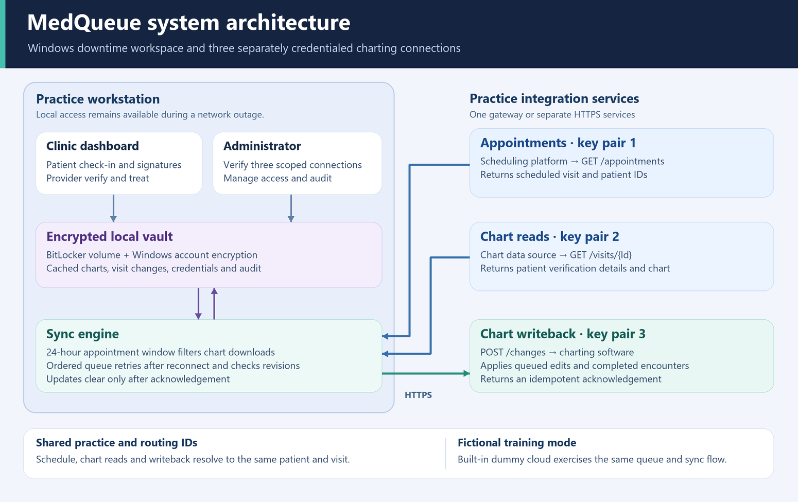

# MedQueue

MedQueue is a Windows desktop pilot for clinic downtime. A practice workstation keeps a local copy of upcoming patients' charts and can continue checking patients in, collecting form signatures, and documenting care while a cloud service is unavailable.

## Install

Download the [Windows installer](dist-download/MedQueueSetup.exe) and open it while signed into the designated Windows account. Choose an unlocked fixed NTFS volume with BitLocker protection on and encryption complete. Setup places the executable and vault on that drive and adds a Start menu shortcut. The designated Windows account must have permission to create and write the workspace. The installer is unsigned.

### Choose where MedQueue stores its vault

Selecting a drive in Setup does not encrypt, format, or repartition it. Setup verifies that the selected Windows volume is already fully encrypted with BitLocker and that protection is on. It then creates the MedQueue workspace folder on that volume. The vault has an additional layer of encryption tied to the designated Windows account.

If the drive is locked, open it in File Explorer and unlock it through Windows before running Setup or starting MedQueue. Enter the drive password or recovery key only in Windows. At installation and each app launch, Windows may show an administrator approval prompt for the read-only BitLocker status check. A standard account may need IT to approve this prompt. Keep Setup and MedQueue running under the designated account so the vault uses that account's Windows encryption keys. If Setup verifies BitLocker but cannot create the folder, ask IT to grant the designated account permission to create a folder on the selected volume.

To dedicate a small amount of disk space to MedQueue, have IT provision a separate fixed NTFS volume sized for the practice's charts and queued changes. For example, IT could assign a 10 GB volume the letter `M:`, enable BitLocker on that volume, and wait for encryption to finish before selecting it in Setup. BitLocker protects the selected volume, and the other volumes on the same physical disk keep their existing settings. [Microsoft BitLocker documentation](https://learn.microsoft.com/en-us/windows/security/operating-system-security/data-protection/bitlocker/)

The current installer requires an existing volume. A size-limited virtual disk file is a possible future setup option for allocating dedicated storage without repartitioning the physical disk. Any such workflow would need to verify that the virtual volume can be mounted and unlocked after a restart, including during an outage. [Microsoft virtual disk documentation](https://learn.microsoft.com/en-us/windows-server/storage/disk-management/manage-virtual-hard-disks)

Create the first practice administrator when opening the workspace. Create named provider accounts through **Add provider**. The first account is the practice administrator, so IT should provision the workspace before making it available at the check-in workstation.

New administrator and provider passwords must be 14–256 characters and include an uppercase letter (`A–Z`), a digit (`0–9`), and at least one of `!@#_+-=`. Enter the same password twice. **Show passwords** reveals both entries while you check them.

## Run a fictional outage drill

1. Sign in as administrator and select **Start training clinic**. Two fictional visits enter the vault. A third visit sits outside the download window.
2. Choose **Find and verify patient**. Try **Avery Sample**, **1988-04-12**, and **202-555-0110**. The appointment opens only after all three details match. The second test patient is **Jordan Example**, **1979-09-23**, **202-555-0111**.
3. Choose **Mark patient signed in** to open **Current visit**. Use the **Doctor chart**, **Prescriptions**, and **Referrals** tabs. If the patient needs to sign a form, create a template and issue a one-use patient access code from the verified appointment. MedQueue signs out the provider. The patient can use the code and their fictional name to sign the form. Sign back in and verify the patient again to return to the visit.
4. Use **Toggle training outage**, enter fictional visit updates, and select **Complete appointment**. The visit becomes read-only and its chart handoff stays in the encrypted queue. Restarting MedQueue during the outage preserves the queue. Reconnect with **Toggle training outage** and verify that the completed visit shows the cloud adapter's acknowledgement.

## Link a practice adapter

Install a separate workspace for a live integration. As a practice administrator, open **Charting connections** and enter the HTTPS adapter base URL, API key ID, and secret on each tab.

| Connection | Purpose |
| --- | --- |
| Appointments | Pull the schedule for appointments starting within the next 24 hours. |
| Chart reads | Fetch the chart for each eligible appointment. |
| Chart writeback | Send queued changes and completed visits to the charting system. |

Use a distinct key pair for each role. The URLs may point to three services or to a single gateway that enforces the three grants. **Verify and link** checks the role claimed by each credential and requires matching practice and record routing IDs. MedQueue stores the three pairs in the encrypted vault after administrator approval. To rotate one pair, supply its new ID and secret and leave both key fields blank on the other tabs. Changing an endpoint URL requires entering its key pair again.

MedQueue uses the [HTTPS adapter contract](ADAPTER.md). A clinic's integration team connects those adapter routes to each vendor's API or approved database interface. Existing single-credential configurations can continue syncing. Complete active visits and drain the existing queue before migrating to three pairs for the same patient and visit ID mapping.

## How downtime works

- While MedQueue is open, it attempts sync at startup and every 15 seconds, including at the locked sign-in screen. Keep the app running on the designated workstation before an outage to populate the cache.
- MedQueue downloads charts for scheduled appointments starting in the next 24 hours. It retains previously downloaded visits for up to 24 hours after the start time and keeps active visits or visits with pending changes until closed or reconciled. An appointment created while disconnected can only appear after the adapter becomes reachable.
- Visit check-ins, signed form snapshots, clinical records, and prescription documentation are persisted with their queued changes. Stable event IDs and revision checks protect retries. Use **Review sync conflict** to compare the cloud and local values and authorize a retry against the reviewed revision. The adapter must implement atomic revision checks and idempotency.
- Completing an appointment queues a structured handoff with the visit identifier, timestamps, provider, and chart entries, prescriptions, signed forms and referral requests recorded for that encounter. The adapter receives the completion event after earlier visit changes. Its acknowledgement means that the adapter has accepted the visit under its integration contract. Referrals and prescriptions require the receiving system's own delivery and authorization workflows.
- Audit activity, form templates, credentials, and clinical data are protected with Windows DPAPI under the designated Windows account. The file is replaced atomically. Windows filesystem permissions restrict the workspace to the designated account and Local System. Team access is provided by named logins within a single running workspace on a single workstation.
- Prescription changes are chart documentation. Pharmacy transmission and controlled-substance prescribing require their own validated workflows. Form templates and workstation audit events remain local.

## Production readiness

Use fictional data for this pilot. HIPAA compliance is an organizational determination involving administrative, physical, and technical safeguards. Before introducing patient data, validate the EHR integration and chart completeness, independently review the application and deployment, establish applicable business associate agreements, and drill backup and recovery of the Windows DPAPI profile and vault together. Vet workstation and account management, access reviews, prescribing and signature workflows, and audit retention. This implementation uses a local audit history and does not implement centralized tamper-evident retention, MFA, multi-workstation access, or an unattended Windows service. A workstation failure can interrupt local access. See the [HHS Security Rule summary](https://www.hhs.gov/hipaa/for-professionals/security/laws-regulations/index.html).

## Build and test

From this directory in Windows PowerShell, run `./build.ps1 -Test`. The build uses the Windows .NET Framework 4.8 compiler and libraries. It creates `dist/MedQueue.exe` and `dist/MedQueueSetup.exe`. The integration smoke test uses fictional records and exercises persistence and sync without requiring a BitLocker deployment. The application and installer themselves require BitLocker.
